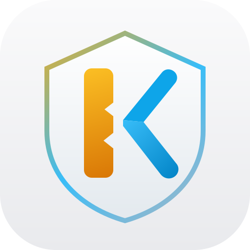
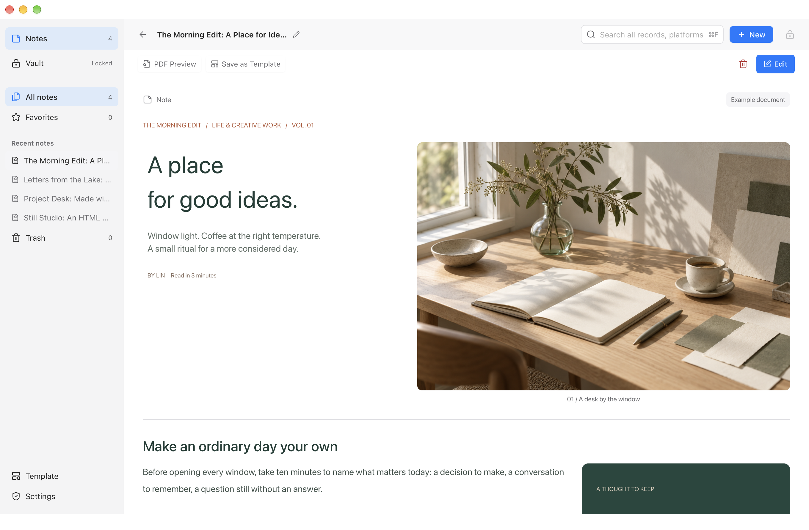
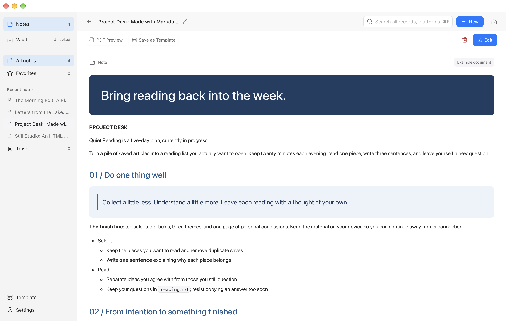
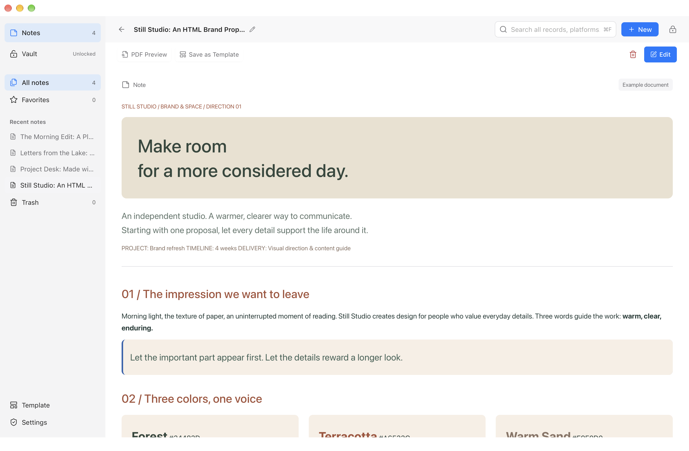
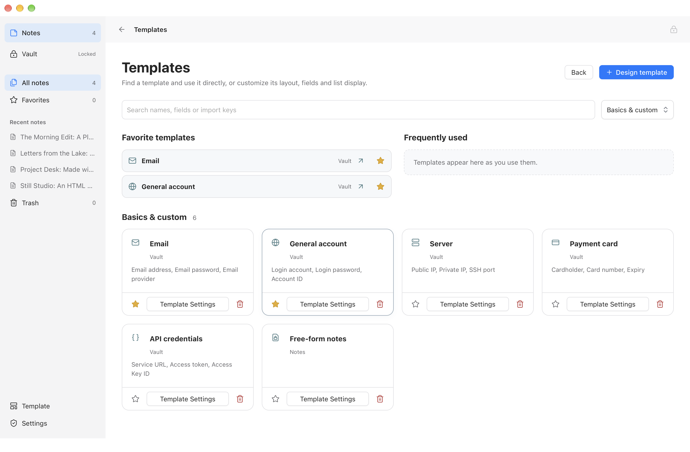

<p align="center"></p>

<h1 align="center">Kernpad</h1>
<p align="center">Capture ideas. Compose documents. Keep accounts close.</p>
<p align="center"><a href="README.md">简体中文</a>　<a href="docs/guide.en.md">User guide</a>　<a href="CONTRIBUTING.en.md">Contributing</a>　<a href="SECURITY.md">Security</a></p>

Kernpad is a local notes app and password manager for macOS and Windows. Compose with rich text, Markdown, HTML, images and video. Reuse layouts and fields through custom templates, and keep confidential records in an encrypted vault.

**Works offline without a cloud account.** English and Simplified Chinese interfaces, with light and dark appearances. Version **1.0.0**, licensed under [MIT](LICENSE).



Every interface image comes from the real macOS application with an isolated synthetic library. The Chinese guide has matching localized interfaces and documents. Click an image to inspect it.

An account often needs deployment notes, a few useful links or an illustrated procedure. Kernpad keeps structured fields and free-form documents in the same record: fields hold credentials, text explains their purpose, and links connect related accounts and email records. Ordinary notes and protected records share an editor; choose Notes or Vault according to the content.

## From a quick note to a complete document

Combine paragraphs, headings, quotes, callouts, tasks, nested lists, tables, code, dates, tags, links, forms, verification codes, images and video. Type `@` on an empty line or use the adjacent `+` to insert a component. Insert between existing blocks, drag to reorder, or select several for a shared adjustment.


- **Precise columns:** a 12-unit grid supports halves, thirds and quarters, with explicit starting columns and spans when needed.
- **Asymmetric layouts:** span a component across rows, such as one large image beside two stacked passages. Backgrounds can fit their content or share a row height.
- **Detailed styling:** adjust type size, text color, alignment, spacing, padding, backgrounds, borders and corner radii. Show or hide the document title and description.
- **Media in place:** drag local images or video into the intended column, then adjust their size and position. Media stays with its record; reading mode hides editing controls.
- **Edits you can undo:** undo and redo cover text, fields, media and layout. Code blocks can format JSON, and lists support indentation and outdentation.

### Bring Markdown and HTML into your editing workflow

| A Markdown project plan | An HTML brand proposal |
| --- | --- |
|  |  |
| Headings, nested lists, tasks, tables and code become editable components. | Supported colors, type sizes and structure are retained; scripts and remote embeds are removed. |

Import supports a practical subset, not full CommonMark or pixel-perfect reproduction of arbitrary websites. Four editable examples in each language demonstrate an illustrated journal, a travel story, Markdown, HTML and local video.

### Preview the PDF when you are ready to share

Everyday editing uses the available window width. A4 preview reuses the same content snapshot as export, proportionally scaling columns, type and spacing. Videos become posters and secret fields remain masked. See the [actual PDF preview and export guide](docs/guide.en.md#pdf-preview-and-export).


Fit the width, fit the page or choose a zoom level. Closing preview returns to the editing position. Manual-save users can preview their current changes without committing them to the saved record.

## A vault for more than passwords

A server record can contain its login credentials, console links, deployment steps and screenshots. A website account can link to its registration email and include recovery instructions. Keep accounts, API credentials and confidential documentation together.


- **Fields you define:** edit names, types, required status and secrecy, or add a project ID, environment or other business field. Built-in templates cover 20 record types, including email, servers, databases, SSH, APIs, cards and software licenses.
- **Platforms and useful links:** define a platform name, URL and local logo, then add shortcuts to sign-in, billing or administration pages within a record.
- **Connected records:** choose **Linked records** at the top of a record to search for and connect email or other accounts. The entry is available when reading or editing; Cancel leaves existing links unchanged. Quick Paste can create or reuse linked email records; conflicting credentials or ambiguous addresses stop the write.
- **Verification codes beside credentials:** view and copy current TOTP codes from a record or the unlocked list. Supported parameters are a Base32 seed, SHA-1, six digits and a 30-second period.
- **A useful list view:** read the main account and public URL, or click a masked password to copy it without opening the record. Clipboard content is cleared after 30 seconds if it has not been replaced; this cannot retract content already read by another app.
- **Search within defined boundaries:** find records by name, platform and fields. Unlocked body search matches records in the native host without a persistent plaintext body index; passwords and verification-code seeds are excluded.

Use system authentication for everyday access. Switching to Notes keeps an active session until the configured idle or lock policy ends it. A recovery key covers device changes, loss of the original vault or unavailable system authentication. **Ordinary notes are plain text. Put confidential content in Vault.**

### Complete everyday tasks from the list

Open **All records** in Vault to browse accounts across platforms. Narrow the list by category, platform or search. Dedicated account, password, verification-code and linked-record columns let you copy what you need without opening each record.


| List content | Available action |
| --- | --- |
| Account | Read and copy the primary account; open the record name for full details |
| Password or credential | Keep it masked on screen and use its copy button |
| Verification code | See the current code and remaining time, then copy the current code |
| Linked details | Open the linked email record or copy its account and password directly |

All records above are fictional. The list requests bounded display data; the native host handles password copying, and list previews do not return password values or verification-code seeds.

## Templates that fit your work

Templates define document layout, field structure, paste rules and list presentation together. Start from a blank design or save an existing document as a template for project records, working notes or account files.



### Turn a layout into a reusable structure

- **Generate rule fields from the design:** document components and forms become configurable fields. Change their names, import keys and inclusion in Quick Paste. Internal component IDs preserve field associations when components move.
- **Keep the layout, clear the credentials:** reuse columns, colors, instructions and media. Accounts, passwords, form values and verification-code seeds are cleared by default. Review ordinary text and attachments before saving a template.
- **Connect fields to the vault list:** explicitly select the account, password, URL and verification-code fields used in the list. For example, map a custom Access token field to the password column and Console URL to the URL column.
- **Separate defaults for Notes and Vault:** choose a template for each area and apply it immediately on creation. Search, favorites and frequently used templates are available in the main workspace. Six basic templates and your custom templates appear by default; search or change the filter to find the other built-in types.

Editing template structure and rules does not require unlocking the vault; reading actual credentials does. Template changes primarily apply to subsequently created records, while existing records keep their content. Automatic list matching uses fixed local rules, with manual mappings taking priority. See [field and list mapping](docs/guide.en.md#component-ids-import-keys-and-list-fields) for precedence and empty-value behavior.


Choose **Save as Template**, then edit the generated fields in place. This example adds **Environment** with the import key `custom.environment`, makes **Project ID** required, and excludes **Sign-in URL** and **Usage notes** from Quick Paste while retaining them in the template. Set the name, destination and list mappings, then choose **Save template** to reuse it.

### Turn your text format into records

If your source data is a line of delimited text, define where each column belongs. For example:

```text
{$account}----{$password}----{$custom.project_id}----{$email.account}
```

This rule fills the account, password, project ID and linked email in that order. Use a comma, tab, pipe or a custom delimiter such as `----`. Add, remove, reorder and remap import columns.

Preview the parsed values before filling the current record, or create records in bulk from multiple lines. Previews mask secret values, unmapped fields keep their existing values, and malformed input is blocked. Quote values containing the delimiter. See the [Quick Paste example](docs/guide.en.md#configuring-and-using-quick-paste) for details.

## Give temporary content an expiry date

Temporary notes suit short-lived checklists, fragments to organize and information needed for the day. The default is one day, configurable from **one minute to 365 days**. Set it once; new temporary notes use it without another duration dialog.

Each note displays its expiry time. Adjust it individually or keep the note permanently. Expiration removes its content, attachments and local drafts without Trash or application backups. If the app is closed at expiry, cleanup runs at the next launch. It cannot retract copied or exported content and does not promise secure erasure from storage media.

## Work the way you prefer

| Preference or situation | Kernpad's behavior |
| --- | --- |
| Get straight to work | Choose Notes or Vault as the startup page, each with its own default template |
| Save as you write | Autosave avoids repeated Saved flashes; longer writes show progress, and failures retain edits with a retry action |
| Decide when to save | Disable autosave; the Save button reflects changes, and navigating or quitting offers Save, Discard or Cancel |
| The vault locks while editing | Uncommitted private changes are stored as a separate encrypted local draft and can resume after unlocking; drafts are excluded from backups |
| Prefer the keyboard | Customize shortcuts for New, Save, Find, Lock and navigation, with conflict checks and reset options; fixed editing shortcuts are listed alongside them |
| Organize several records | Drag a selection rectangle in empty space, add or remove items with Command / Ctrl, or select a range with Shift; deletion asks for confirmation and ordinary deleted records can be restored from Trash |

The editor distinguishes a new paragraph, a line break within a paragraph and a new full-width row. The [user guide](docs/guide.en.md#shortcuts) explains shortcuts, saving behavior and draft limitations.

## Install

| Platform | Requirements |
| --- | --- |
| macOS | Apple Silicon, macOS 14+ |
| Windows | Windows 11 x64, Microsoft Edge WebView2 Runtime |

The minimum window width is 1280 logical pixels. Intel Mac, Linux and supported Windows ARM64 packages are not available. Windows virtual machines have been used for interface and workflow validation; **successful Windows Hello / TPM authentication still requires acceptance on supported physical hardware**.

Check [Releases](https://github.com/iAsuner/Kernpad/releases) for a matching package and verify its SHA-256 against the same release. If no package is available, build from source below.

The default local macOS build is ad-hoc signed and not Apple-notarized. Windows has no configured trusted publisher signature; self-signing does not establish system trust. Complete system prompts yourself without disabling system security protections. See the [installation guide](docs/guide.en.md#platforms-and-installation).

<details>
<summary>Ask an AI to install it</summary>

> Install Kernpad from https://github.com/iAsuner/Kernpad: read the repository instructions and Releases, identify my system, download a matching official package and verify its SHA-256 and signature; if no package is available, build according to the repository. Preserve existing data and signing continuity. Handle downloads and commands for me; I will complete system authentication. Stop and explain any unsupported platform or failed verification.

The AI needs to download and install locally, but you do not need to download the repository first. Never give it real passwords, recovery keys or a personal library.

</details>

## Build from source

macOS requires Xcode Command Line Tools, Python 3.9+ and Node.js 22+:

```sh
zsh Source/test.sh
zsh Source/test-documents.sh
zsh Source/build.sh
open Kernpad.app
```

Windows requires .NET 10 SDK, Python 3.9+, Node.js 22+ and WebView2 Runtime:

```powershell
powershell -File Windows/build.ps1
```

No npm installation is needed. Web resources are generated from source; do not edit generated `app.js`, `app.css` or `index.html`. Build, update and validation details are in [Contributing](CONTRIBUTING.en.md) and the [architecture guide](docs/architecture.en.md).

## Security and backups

Protected records are encrypted individually with AES-256-GCM. macOS unlocking depends on an actual Secure Enclave protected-key operation. The Windows implementation depends on Windows Hello private-key operations and TPM checks. This release accepts only Kernpad v3 vaults and backups.

There is no built-in cloud sync or telemetry, and you choose where backups are saved. Encrypted backups support transfer between Mac and Windows; restoration creates a new local library and retains the original. When the original device and library remain available, fresh system authentication can restore a matching backup. Otherwise, use its recovery key. Switch between local libraries in Settings.

Keep your recovery key separately and make encrypted backups regularly. Temporary notes and uncommitted drafts are excluded from backups; exported PDFs are not encrypted. The app cannot protect against an attacker controlling its process and does not prevent whole-library rollback. It has not undergone an independent third-party security audit.

Read the [security policy](SECURITY.md) for the protection boundaries and vulnerability reporting process. Do not upload real credentials or personal libraries to issues.

## Contributing and license

Reproducible bug reports, interface improvements, translations and code contributions are welcome. Use synthetic data and record your validation following [Contributing](CONTRIBUTING.en.md).

The maintainer defines product requirements and acceptance. Code is written and iterated with **GPT-6**; that does not replace code review or security auditing. Example images are AI-generated, and the video is an original still-image animation. [Asset provenance](Source/Examples/Media/provenance.json) is included.

Kernpad code is [MIT-licensed](LICENSE). Third-party components retain their own licenses. Platform trademarks do not imply affiliation or endorsement; see [third-party notices](THIRD_PARTY_NOTICES.txt).
