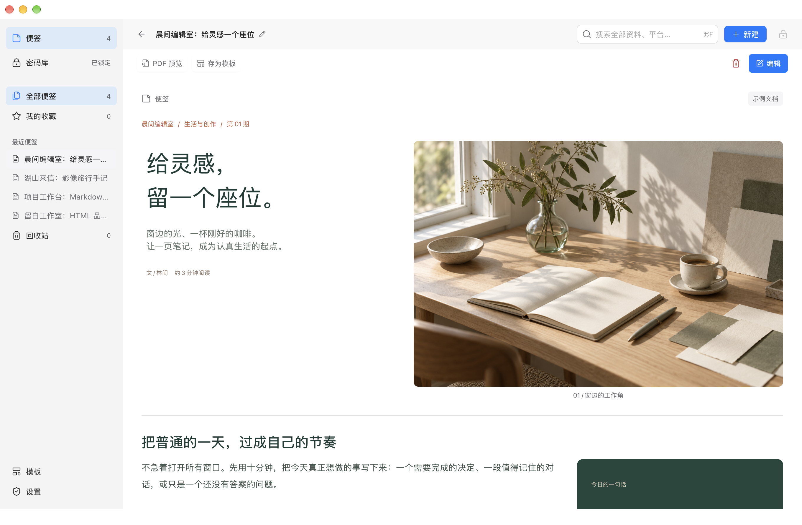
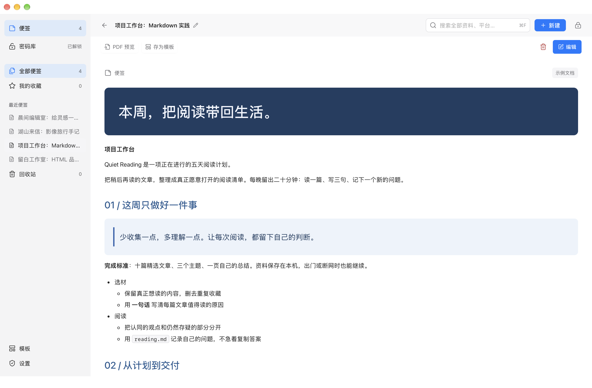
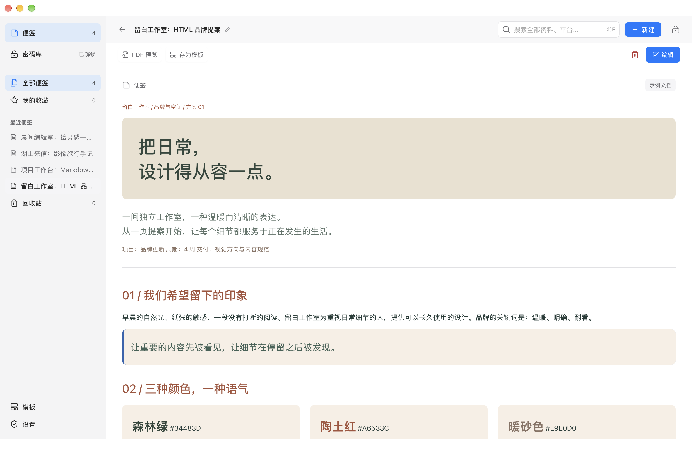
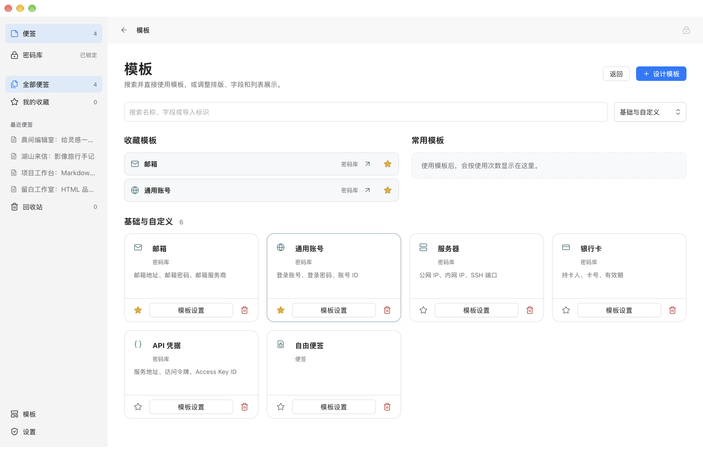

<p align="center"></p>

<h1 align="center">Kernpad</h1>
<p align="center">写下想法，整理文档，保管账号。</p>
<p align="center"><a href="README.en.md">English</a>　<a href="docs/guide.zh.md">使用手册</a>　<a href="CONTRIBUTING.md">参与开发</a>　<a href="SECURITY.zh.md">安全说明</a></p>

Kernpad 是适用于 macOS 和 Windows 的本地便签与密码管理器。用富文本、Markdown、HTML、图片和视频组织内容，用自定义模板复用排版与字段，再把需要保密的记录放入加密密码库。

**离线运行，无需云端账号。** 简体中文与英文界面，浅色与深色外观。版本 **1.0.0**，采用 [MIT 许可证](LICENSE)。



所有界面图均采自真实 macOS 应用，使用独立合成资料。英文说明提供对应的英文界面和文档，图片可点击放大。

账号往往还需要一份部署说明、一组入口链接或一张操作截图。在 Kernpad 中，结构化字段与自由排版可以放在同一条记录里：用字段管理凭据，用正文说明用途，用关联记录连接邮箱与其他账号。普通写作与受保护资料共用编辑器，按内容选择保存到便签还是密码库。

## 从一条便签到一篇完整文档

正文、标题、引用、提示块、待办、层级列表、表格、代码、日期、标签、链接、表单、验证码、图片与视频可以自由组合。空行输入 `@` 或点击行旁的 `+` 插入组件，也可以在文档中间补充内容、拖动排序和多选调整。


- **精确分栏**：采用 12 格布局，支持半栏、三分之一栏、四分之一栏，也可指定起始格与占用格数。
- **错落组合**：组件可以纵向跨行，例如左侧一张大图，右侧上下两段文字；背景可选随内容高度或同排等高。
- **细调样式**：设置文字颜色、字号、对齐、内外间距、背景、边框与圆角。整篇标题和说明可按需显示。
- **媒体直接入栏**：把本地图片或视频拖到目标栏位，继续调整尺寸和位置。媒体随记录保存，阅读时隐藏编辑控件。
- **编辑可回退**：文字、字段、媒体和排版支持撤销与重做；代码块可格式化 JSON，列表可缩进与退级。

### Markdown 和 HTML，导入后继续编辑

| Markdown 项目计划 | HTML 品牌提案 |
| --- | --- |
|  |  |
| 标题、层级列表、待办、表格和代码转换为组件。 | 保留支持的颜色、字号和结构，移除脚本与远程嵌入。 |

导入支持实用子集，不承诺完整 CommonMark 或任意网页的像素级还原。应用内提供四篇可编辑的中英文示例，包含图文杂志、旅行手记和本地视频。

### 需要交付时，再切换到 PDF

日常编辑充分利用窗口宽度；导出前打开 A4 分页预览。预览与导出复用同一内容快照，按原栏位、字体和间距等比缩放。视频使用封面，秘密字段保持遮挡。查看[PDF 实际预览与导出说明](docs/guide.zh.md#pdf-预览与导出)。


可选择适合宽度、适合整页或自定义缩放，关闭预览后回到编辑位置。手动保存模式下也能预览当前修改，预览不会替你提交正文。

## 密码库，也是你的资料库

一条服务器记录可以同时包含登录凭据、控制台入口、部署步骤与截图；一条网站账号可以关联注册邮箱，并保存恢复说明。账号、密码、API 凭据和受保护文档不必拆散到不同应用。


- **字段由你定义**：修改字段名称、类型、必填与保密属性，添加项目编号、环境或其他业务字段。内置模板覆盖邮箱、服务器、数据库、SSH、API、银行卡、软件许可等 20 类记录。
- **平台与入口可扩展**：自建平台名称、网址和本地 Logo，在同一记录中设置登录页、账单页或管理控制台等快捷入口。
- **记录之间有关联**：在记录顶部点击“关联记录”，搜索并连接邮箱或其他账号，沿关联跳转查看。阅读和编辑时都可使用，取消不改变原关联。快捷粘贴可创建或复用关联邮箱，遇到凭据冲突或同地址歧义会停止写入。
- **验证码与凭据同处一页**：支持标准 TOTP 动态验证码，并可在解锁后的列表查看、复制当前代码。支持范围为 Base32 密钥、SHA-1、6 位数字和 30 秒周期。
- **列表可以直接使用**：查看主要账号与公开网址，点击掩码密码复制，不必逐条打开详情。复制内容在 30 秒后清理，期间复制的新内容不会被误清除；这不能撤回其他程序已经读取的内容。
- **查找保留保护边界**：按名称、平台和字段查找；解锁后的正文搜索在原生层逐条匹配，不建立持久化明文正文索引，密码与验证码密钥不参与正文匹配。

日常访问使用系统验证，切换到便签后保留当前会话，按闲置时间和锁定策略结束。恢复密钥用于换设备、原库丢失或本机验证不可用。**普通便签为明文；私密内容应放入密码库。**

### 在总列表里完成常用操作

打开密码库的“全部记录”，集中浏览不同平台的账号，按类型、平台或搜索结果缩小范围。账号、密码、动态验证码和关联资料各有独立位置，日常复制无需逐条进入详情。


| 列表中的内容 | 可以直接完成的操作 |
| --- | --- |
| 账号 | 查看主要账号并复制，点击记录名称进入完整资料 |
| 密码或凭据 | 保持掩码显示，点击复制按钮取得对应值 |
| 动态验证码 | 查看当前代码与剩余时间，点击复制当前验证码 |
| 关联资料 | 打开关联邮箱，或直接复制关联账号与密码 |

上图全部使用虚构资料。列表只请求有限的展示数据，密码复制由原生层处理，密码正文和验证码密钥不会随列表预览一起返回。

## 让模板适应你的工作

模板同时定义文档排版、字段结构、粘贴规则与列表展示。可以从空白开始，也可以把已有文档“存为模板”，用于重复创建项目资料、工作记录或账号档案。



### 从排版生成可填写的结构

- **保存时自动整理规则字段**：从文档组件与表单中生成可配置字段，再修改名称、导入标识及是否参与快捷粘贴。组件内部 ID 自动维护，重排后仍能对应原字段。
- **排版与普通内容保留，凭据清空**：复用颜色、分栏、说明和媒体，账号、密码、表单值与验证码密钥默认不作为新记录的内容。普通文字和附件应在保存前自行检查。
- **与密码库列表衔接**：明确指定哪个字段用作列表账号、密码、网址或验证码。例如把自定义“访问令牌”映射为密码列，把“控制台地址”映射为网址列。
- **按板块设定默认模板**：便签和密码库各自选择默认值，新建时直接套用。模板主页支持搜索、收藏与常用排序，默认展示 6 个基础模板和自定义模板，其余内置模板可搜索或切换查看。

编辑模板结构和规则无需解锁密码库；读取实际凭据时才验证。模板修改主要用于之后新建的记录，已有记录保留原内容。列表自动识别采用本机固定规则，手动映射优先，具体顺序与空值处理见[字段与列表映射](docs/guide.zh.md#组件-id导入标识与列表字段)。


点击“存为模板”后，自动生成的字段仍可直接编辑。上图添加了“使用环境”，导入标识设为 `custom.environment`；将“项目编号”设为必填，并取消“登录地址”和“使用说明”的导入勾选，让它们留在模板中而不参与快捷粘贴。设好名称、所属板块与列表映射后，点击“保存模板”即可复用。

### 按自己的文本格式快捷录入

已有资料是一行用分隔符连接的文本时，可以直接定义每一列的去向。例如：

```text
{$account}----{$password}----{$custom.project_id}----{$email.account}
```

这条规则依次填入账号、密码、项目编号和关联邮箱。分隔符可选逗号、Tab、竖线，或 `----` 等自定义文本；导入列可以增减、排序和重新指定字段。

先预览识别结果，再填入当前记录；多行文本可批量新建。预览遮挡秘密值，未映射字段保留原值，格式错误会阻止填入。值中包含分隔符时可以用双引号包裹，详见[快捷粘贴示例](docs/guide.zh.md#配置与使用快捷粘贴)。

## 给短期内容设置保留期限

临时便签适合临时清单、待整理的片段和当天要用的资料。默认保留一天，可设置为 **1 分钟至 365 天**；设置一次后，新建直接使用默认期限，不重复弹出选择框。

每篇顶部显示到期时间，可单独调整或转为普通便签。到期清理正文、附件与本机草稿，不进入回收站和应用备份；应用关闭期间到期的内容在下次启动清理。它不会撤回已经复制或导出的内容，也不承诺存储介质上的安全擦除。

## 按自己的习惯使用

| 习惯或场景 | Kernpad 的处理方式 |
| --- | --- |
| 打开就开始工作 | 启动页可选便签或密码库，两边分别使用自己的默认模板 |
| 随写随存 | 自动保存不反复闪现“已保存”；耗时较长才显示进度，失败保留修改并提供重试 |
| 自己决定何时保存 | 关闭自动保存后，保存按钮按内容是否改变启用；切换或退出前可选择保存、放弃或取消 |
| 编辑时密码库自动锁定 | 未提交的私密修改单独加密暂存，解锁后可继续草稿；草稿不进入备份 |
| 常用操作依赖键盘 | 新建、保存、搜索、锁定和页面切换可自定义快捷键，检查冲突并可恢复默认；固定编辑快捷键也集中列明 |
| 整理多条记录 | 支持空白处拖动框选、Command / Ctrl 增减选择和 Shift 连选；删除前确认，普通删除可从回收站恢复 |

编辑器区分新段落、段内换行与另开整行。快捷键组合、保存行为和草稿限制见[使用手册](docs/guide.zh.md#快捷键)。

## 安装

| 平台 | 要求 |
| --- | --- |
| macOS | Apple Silicon，macOS 14+ |
| Windows | Windows 11 x64，Microsoft Edge WebView2 Runtime |

窗口最小宽度为 1280 逻辑像素。暂不提供 Intel Mac、Linux 或受支持的 Windows ARM64 发行包。Windows 虚拟机已用于界面与流程验证，**Windows Hello / TPM 的成功认证仍需受支持真机验收**。

在 [Releases](https://github.com/iAsuner/Kernpad/releases) 中检查是否已有匹配安装包，并核对同次发布的 SHA-256；没有发行包时，按下方说明从源码构建。

macOS 默认本机构建采用 ad-hoc 签名，未经过 Apple 公证。Windows 未配置受信任发布者签名；自签名不会自动获得系统信任。安装与系统验证由本人确认，无需关闭系统安全保护。完整步骤见[安装说明](docs/guide.zh.md#平台与安装)。

<details>
<summary>复制一句话，让 AI 帮忙安装</summary>

> 请从 https://github.com/iAsuner/Kernpad 安装 Kernpad：先读取仓库说明和 Releases，识别我的系统，自动下载匹配的官方安装包并校验 SHA-256 与签名；没有安装包时按仓库步骤构建。保留现有资料与签名连续性，不要求我手动下载或输入命令，系统验证由我本人完成；遇到不支持的平台或失败的检查请停止并说明。

AI 需要在本机下载和安装，但你不必先手动下载仓库。不要向 AI 提供真实密码、恢复密钥或个人资料库。

</details>

## 从源码构建

macOS 需要 Xcode Command Line Tools、Python 3.9+、Node.js 22+：

```sh
zsh Source/test.sh
zsh Source/test-documents.sh
zsh Source/build.sh
open Kernpad.app
```

Windows 需要 .NET 10 SDK、Python 3.9+、Node.js 22+ 和 WebView2 Runtime：

```powershell
powershell -File Windows/build.ps1
```

不需要 npm 安装。Web 资源从源码生成；不要直接修改生成的 `app.js`、`app.css` 或 `index.html`。构建、安装更新、测试范围与项目结构见[贡献指南](CONTRIBUTING.md)和[实现说明](docs/architecture.zh.md)。

## 安全与备份

受保护记录采用 AES-256-GCM 逐条加密。macOS 解锁依赖 Secure Enclave 的真实受保护密钥操作；Windows 实现依赖 Windows Hello 私钥操作与 TPM 检查。当前版本只接受 Kernpad v3 资料库与备份。

应用没有内置云同步或遥测，备份位置由你选择。加密备份可用于 Mac 与 Windows 之间迁移，恢复时创建新的本地资料库并保留原库。原设备与原库仍在时，可经新的系统验证恢复对应备份；换设备或原库丢失时使用恢复密钥。本地资料库之间可以在设置中切换。

请单独保管恢复密钥，并定期导出加密备份。临时便签和未提交草稿不进入备份，导出的 PDF 不加密。应用无法抵御已经控制进程的攻击者，也没有整库旧文件回滚保护。项目尚未接受独立第三方安全审计。

详细保护范围和漏洞报告方式见[安全说明](SECURITY.zh.md)。请勿把真实凭据或个人资料上传到 issue。

## 贡献与许可

欢迎提供可复现的问题、界面改进、翻译和代码。请使用合成资料，并按[贡献指南](CONTRIBUTING.md)记录验证结果。

产品需求和验收由维护者负责，代码使用 **GPT-6** 编写并迭代；这一说明不替代代码审查或安全审计。示例图片为 AI 生成，短片为原创图片运镜，[素材来源](Source/Examples/Media/provenance.json)随源码保留。

Kernpad 代码采用 [MIT](LICENSE)。第三方组件保留各自许可，平台商标不代表合作或背书，见[第三方声明](THIRD_PARTY_NOTICES.txt)。
