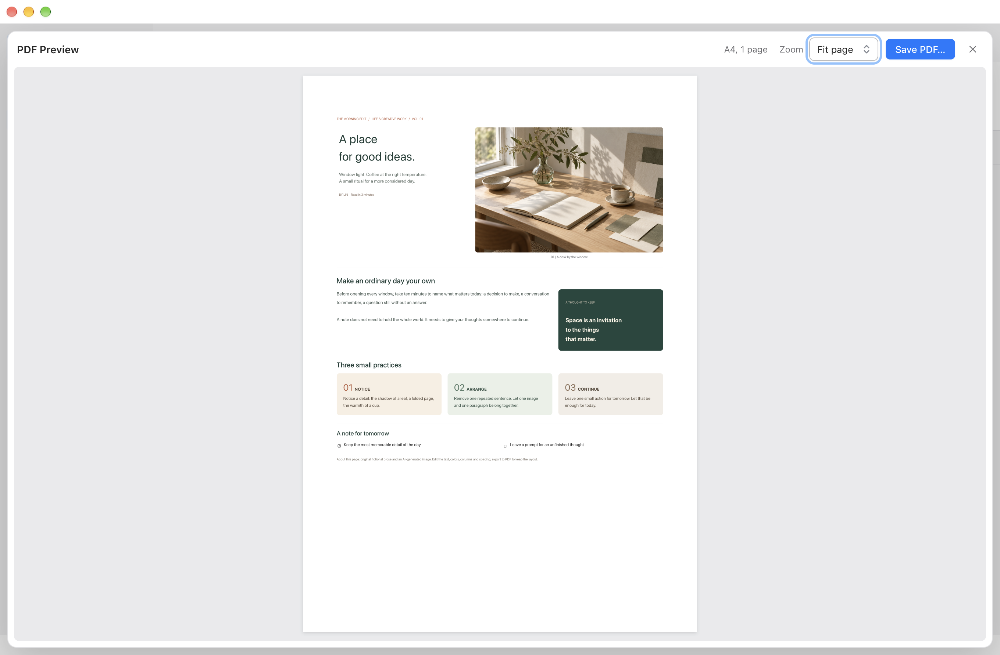
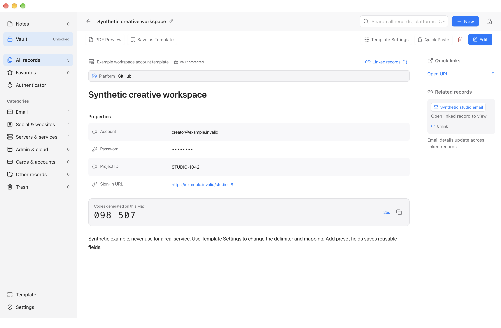
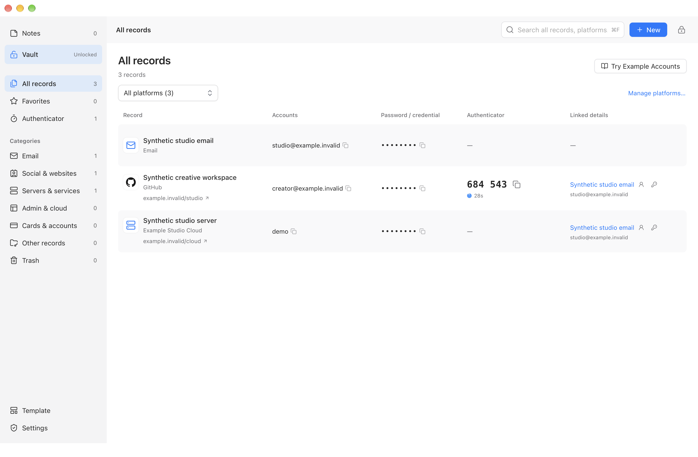
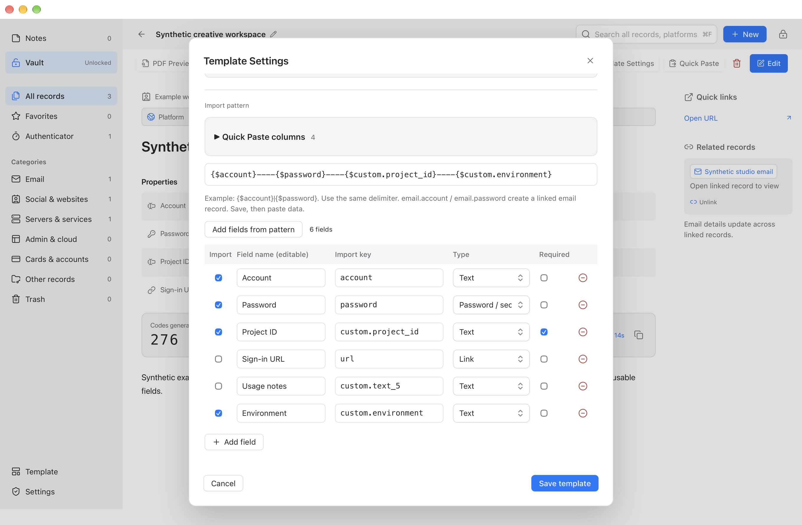

# Kernpad user guide

[Project home](../README.en.md)

[简体中文](guide.zh.md)

**Notes and a password manager in one local workspace.** Kernpad combines Markdown and HTML conversion, rich text, multi-column documents and PDF export with an encrypted vault, linked accounts, custom templates and verification codes.

Version **1.0.0**, licensed under [MIT](../LICENSE). Product requirements are defined by the maintainer; code is **written and iterated with GPT-6**.

## What you can do

| Need | Workflow |
| --- | --- |
| Notes, meetings and project plans | Write with rich text, tasks, tables and code |
| Image journals and design proposals | Combine columns, spanning rows, colored blocks, images and local video, then preview or export PDF |
| Accounts, passwords, servers and API credentials | Use the vault with custom fields, platforms, linked email and verification codes |
| Repeated document structures | Design templates, choose defaults or paste delimited records |
| Short-lived information | Create temporary notes with automatic expiration |

The application runs offline without a cloud account, built-in cloud sync or telemetry. It supports Simplified Chinese, English and system light/dark appearance. Public notes and vault records have different storage protections; see [Security](#security).

## Platforms and installation

| Platform | Requirements and status |
| --- | --- |
| macOS | Apple Silicon, macOS 14 or later; native AppKit and WKWebView |
| Windows | Windows 11 x64; native WPF and WebView2, requiring Microsoft Edge WebView2 Runtime |
| Windows ARM64 | Used for development acceptance in a VM; no supported ARM64 release package yet |
| Intel Mac and Linux | No native client yet |

The default window width is 1360 logical pixels, with a 1280 minimum. Use a desktop large enough to contain it. Successful Windows Hello authentication still requires acceptance on supported physical Windows hardware; VM interface checks do not establish that result.

If a matching platform package has been published, choose it from [Releases](https://github.com/iAsuner/Kernpad/releases), and verify it against `SHA256SUMS.txt` from the same release. Packages reflect their release commit; `main` may contain later fixes.

- macOS: install `Kernpad.app`. Quit normally before updating and preserve the existing signing identity and library.
- Windows: extract the complete directory, for example to `%LOCALAPPDATA%\Programs\Kernpad\1.0.0`, then run `Kernpad.exe`. Keep its DLLs, Web resources and license files. The self-contained release does not require the .NET SDK.
- Default Mac builds use ad-hoc signing without Apple notarization. Windows releases do not have a trusted publisher signature. The system may require personal confirmation; do not disable security protections or trust unknown certificates.

### Ask an AI to install

Give this sentence to an AI that can operate your computer:

> Install Kernpad from https://github.com/iAsuner/Kernpad: read the repository instructions and Releases, identify my system, download the matching official package, verify its SHA-256 and signature, then install it while preserving existing data and signing continuity. Handle downloads and commands for me; I will complete system authentication. Clearly report if no matching release is available.

A private repository requires existing GitHub access. Installation does not require sharing passwords, recovery keys or personal libraries, or cloning the source first. The AI downloads and extracts the application on your computer.

## First launch

1. Choose a language and startup page in Settings → General. Start in Notes or Vault.
2. Click New in Notes to start writing. A new library includes four editable examples; existing libraries can add them through Example Documents.
3. For confidential material, open Vault, complete system authentication and store the recovery key separately. New libraries do not use an additional vault password.
4. Search and use a template, or design your own layout and fields.
5. Choose automatic or manual saving. Settings also lists common actions and shortcuts.

The bundled examples demonstrate an editorial document, a travel journal, a Markdown project plan and an HTML proposal. Original synthetic media is included offline. Examples can be edited or deleted; adding them again does not overwrite existing edits.

## Notes and document editing


### Content and layout

Components include headings, body text, quotes, callouts, tasks, ordered and unordered lists, tables, dates, tags, links, code, forms, verification codes, dividers, images and video. Rich text supports bold, italic, inline code, font size, color and alignment. Code blocks support JSON formatting.

Markdown and HTML are converted into editable components. Markdown implements a practical subset rather than full CommonMark. HTML conversion removes scripts, event handlers, embeds and remote images; it does not execute the original page or guarantee pixel-identical website reproduction.

Type `@` on an empty line, use the adjacent `+`, or choose Insert in the toolbar. New headings and paragraphs start empty; placeholders are not saved as content. Insert between existing blocks, drag to reorder, and select several components for formatting or deletion.

The Layout panel provides:

- A 12-column grid, half/third/quarter widths, full rows and side-by-side placement.
- Vertical row spans and a large-left/two-right arrangement.
- Content-height or equal-height backgrounds within a row, plus spacing, padding, fill, borders and corner radius.
- Separate document heading and description visibility. The heading is hidden by default; an empty description is not displayed.

Click the top document name or use Rename in the sidebar context menu. Renaming preserves heading visibility. A heading or description cross hides that region without clearing its text. An unnamed public note uses its first content line as its list name.

### Images and video

Choose local files or drag them into the document or a specific column. Empty columns are filled directly; existing content is preserved. Images and videos have explicit delete controls. Deletion and a complete media import can be undone. Reading mode hides editing controls.

Original images may be up to 20 MB, videos up to 8 MB, with at most 10 files and 20 MB per import, subject to library limits. Video accepts MP4, MOV and M4V; decoding depends on system codec support. Videos do not autoplay. PDF uses their poster images. Media inherits the record's public or encrypted storage.

### PDF preview and export



Normal reading and editing fill the available window. PDF Preview displays A4 pages, with fit-to-width, fit-to-page and zoom controls. Closing it returns to the editing position.

Preview and export share the same current content snapshot. Column positions, font sizes, spacing and backgrounds scale proportionally from the reading canvas. Preview zoom does not alter the exported page size. Passwords and verification seeds remain masked, and videos become posters. Preview can include unsaved edits in manual mode without committing them. The PDF file itself is not encrypted.

### Saving and undo

Auto-save documents is enabled by default in Settings → General and can be turned off.

| State or action | Behavior |
| --- | --- |
| Automatic saving | Hides the regular Save button and Saved messages, keeping the interface stable while typing |
| Slow automatic save | Shows progress after 0.8 seconds, keeps it visible for at least 0.6 seconds, then quietly hides it |
| Failed automatic save | Immediately shows an error and Retry Save; retains edits |
| No changes in manual mode, or undo returns to saved content | Save is disabled and displays Saved |
| Modified content in manual mode | Save becomes available; use the button or shortcut. Pending writes show progress, and failed writes allow retry |
| Leaving a document or quitting normally in manual mode | Offers Save, Discard or Cancel |
| Vault security locking | Does not wait for a dialog; encrypts pending changes as a separate local draft |
| Reopening the record after unlocking | Resumes the draft; asks before restoring if the saved record has changed |

Undo and redo cover text, fields, media and layout. Their history is cleared when leaving a record or locking. Drafts are excluded from backups; save important changes first. Public notes and their drafts remain plain text. Edits still only in memory before power loss are not guaranteed recoverable. Templates and application settings have their own save actions.

### Temporary notes

Set the default lifetime directly in General settings, from one minute to 365 days, initially one day. Clicking Temporary note immediately creates it with that default, without asking for a duration again.

The document shows its expiration time. Click it to change this note's remaining lifetime or keep it as a regular note. Changing an individual note does not change the default; cancelling does not restart its timer.

Expiration removes content, attachments and local drafts without Trash or application backups. If the app is closed, cleanup runs on the next launch. Unsaved edits share the deadline. Moving the note into the vault cancels expiration. This cannot recall copied or exported content, remove system snapshots or guarantee secure erasure from storage media.

## Vault



### Unlocking and locking

Existing protected records require system authentication or the recovery key. macOS uses a Secure Enclave private-key operation with user-presence access control. Windows uses Windows Hello private-key operations and TPM attestation checks. Cancellation, failure or unavailable authentication leaves the vault locked.

Once unlocked, opening a public note does not immediately lock the vault. Idle time starts from the last application interaction; automatic code refresh does not extend it. Settings controls idle duration, maximum session length and background locking. Manual locking, screen lock, sleep and exit still end the session.

### Fields, platforms and links

Store accounts, passwords, email, servers, API credentials, payment-card details and protected documents. There are 20 built-in template categories. The template workspace initially shows six basics plus custom templates; search or All templates reveals the others.

Fields have names, types, required flags and secrecy settings. Create platforms with a name, URL and local logo, and link other accounts or email records. Renaming a field in one record does not rename it elsewhere.

Choose **Linked records** at the top of a record, search by name, account or platform, select records and choose **Apply links**. This entry is available in both reading and editing modes, including when there are no existing links. Cancel or close leaves links unchanged. Deselecting and applying removes a link without deleting or copying the original record or password. With auto-save off, applying links opens editing mode; choose **Save** to commit the changes. Link edits support undo and redo while editing.

The unlocked list shows the primary account, public URL, password-presence indicator and current codes for the visible page. Secret account identifiers stay masked. Clicking a masked password copies it through native code; the list receives neither the password nor verification seed. TOTP supports Base32, SHA-1, six digits and a 30-second period. SMS codes are not TOTP.

An authenticator in a public note may explicitly use public storage. Its seed is then plain text; confidential authenticators belong in the vault.

### Search, selection and deletion



**All records** brings the current vault's record types together. Use the copy button beside an account, masked password or current verification code to copy that value. Linked details also let you open an email record or copy its account and password. The native host copies passwords; list previews contain neither password values nor verification-code seeds. Filter by platform or search to narrow the list.

Find records by name, platform and fields. Protected body search runs record-by-record in native code while unlocked, returning at most 100 IDs without a persistent plaintext body index. Passwords, verification seeds, secret account identifiers and Trash are excluded from body matching.

Drag from empty list space to select note cards or vault rows. Command-click on Mac or Ctrl-click on Windows toggles items; Shift-click selects a range. Selection circles stay hidden until selection mode or keyboard focus, replacing existing icons without moving the layout. Escape clears selection. Select All acts only on the current selectable list.

Deleting documents or multiple records requires confirmation, initially focused on Cancel. Confirmed records go to Trash, where their identity and links can be restored. Permanent deletion requires explicit confirmation. Temporary-note expiration bypasses Trash.

## Custom templates and Quick Paste

### Using and designing templates

Templates opens directly in the main content area. Search by name, field or import key. Favorites and frequently used templates appear at the top; click a template to use it. Preferences and usage are stored locally.

Start with Design template or choose Save as Template in a document. Saving keeps layout, ordinary text and media while clearing accounts, passwords, form values and verification seeds. Template structure and public samples are plain text, so inspect ordinary text and attachments for embedded secrets before saving.

Template Settings combines the name, category, destination, fields, import rules and list display. Custom document templates can target Notes or Vault. Add field inserts an editable row; names, types and new import keys are editable in place. Empty field names cannot be saved.



Here, **Environment** uses the custom import key `custom.environment`, and **Project ID** is required. Unchecking **Sign-in URL** and **Usage notes** removes them from Quick Paste without removing them from the template. After choosing **Save template**, find it in the template workspace to use it or continue editing.

Default note and vault templates are configured separately. New in Notes always creates a note; Vault uses its own default through normal authentication. Missing or archived defaults fall back safely. Template edits mainly affect new records and preserve existing content.

### Component IDs, import keys and list fields

| Term | Purpose |
| --- | --- |
| Internal component ID | Generated and hidden; identifies the same component after reordering. New documents receive their own IDs |
| Field name | User-facing text that can be renamed |
| Import key | Stable Quick Paste address, such as `custom.project_id`; visible at the top of Layout for the selected component |
| Quick Paste rule | Defines the delimiter and destination of each column |
| Vault list display | Chooses the account, password, URL and verification-code fields shown outside the record |

Template settings can be edited while the vault is locked. Reading or copying actual credentials still requires a valid session. Stable field/component bindings keep pasted values pointed at the same target after reordering.

### Automatic list matching

How automatic matching works explains the fixed local rules beside the list mappings. Manual choices take priority. Basic fields are checked before document forms, with the first field at each priority level selected.

- Account: finds the import key `account`, then built-in account labels, then the first non-secret field.
- Password: finds `password`, then stored labels containing 密码 (password) or 两步验证凭据 (two-step credential), then a secret field, excluding entry addresses, private keys, card numbers and bank accounts.
- URL: prefers URL or shortcut fields and uses a valid public HTTP/HTTPS address. Record links are checked only when those fields do not exist. URLs containing login credentials are excluded.
- Code: uses existing authenticators and code components; a manual choice limits it to that field or component. Seeds are never displayed in the list.

An account or password match stays selected even when empty. For custom or English field names, choose fields explicitly. Mapping changes affect subsequently created records.

### Configuring and using Quick Paste

Choose a delimiter, add or remove columns, select target fields and reorder them. Supported delimiters include a pipe, comma, Tab and a custom delimiter up to 12 characters. For example:

```text
{$account}----{$password}----{$custom.project_id}----{$email.account}
```

Paste synthetic data:

```text
creator@example.invalid----"Example----Password"----STUDIO-1042----studio@example.invalid
```

Inspect the preview, which masks passwords and seeds, then confirm to fill the current record. Multiple lines can create multiple records. Quote a complete column if it contains the delimiter; double quotes inside a quoted value are written twice. Invalid input blocks submission, and unmapped fields retain their values.

`email.account`, `email.password` and `email.totp` create or reuse a linked email record. Conflicts or ambiguous duplicate addresses block writes rather than silently overwriting credentials. Up to 24 columns can be mapped per paste. Templates allow up to 256 rule fields and 5,000 components, subject to the 32 MB storage limit.

## Shortcuts

Settings → Shortcuts lists customizable and fixed actions, checks conflicts and can restore defaults. “Primary” below means Command on macOS and Ctrl on Windows.

| Action | Default | Editable |
| --- | --- | --- |
| New, Save, Search | Primary + N, Primary + S, Primary + F | Yes |
| Lock vault | Primary + Shift + L | Yes |
| Edit or read | Primary + Shift + M | Yes |
| Notes, Vault, Settings | Primary + 1, Primary + 2, Primary + , | Yes |
| Undo, Redo | Primary + Z, Primary + Shift + Z; Windows also accepts Ctrl + Y | No |
| Bold, Italic, Inline code | Primary + B, Primary + I, Primary + E | No |
| Cut, Copy, Paste, Select All | System shortcuts | No |
| New paragraph or list item within the column | Enter | No |
| Line break within a paragraph | Shift + Enter; Control + Enter also works on Mac | No |
| New full row after the current row | Command + Enter on Mac, Ctrl + Enter on Windows | No |
| Indent or outdent lists/code | Tab, Shift + Tab | No |
| Close a dialog or cancel selection | Escape | No |

## Backup, recovery and security

### Backups and recovery keys

Each vault has an independent random 256-bit data key. Records use AES-256-GCM with record identity included in authentication. This release accepts only Kernpad v3 vaults and backups. Legacy format conversion is not included.

The system random generator creates a recovery key containing 256 random bits, displayed as eight groups totaling 64 hexadecimal characters. System authentication serves everyday access. Store the key separately for another device, loss of the original vault or unavailable local authentication.

Backups re-encrypt records individually. Restoration creates a new library and preserves the original. If the original device and vault remain available, fresh system authentication can restore the matching backup; otherwise use the recovery key. Drafts and temporary notes are excluded from backups, so save important content first.

After three consecutive failed recovery attempts, the process introduces cooldowns starting at two seconds and increasing to 60 seconds. Success resets the counter; restarting the app also resets it. Offline backups can be tried repeatedly. Their protection depends on the random key's strength and secrecy, not interface throttling. Old-format backups cannot be imported directly into this release.

### Security

- Public notes, public authenticator seeds, template structure and public template samples are plain text. Use Vault for credentials and confidential documents.
- Bodies are opened one record at a time. Preview requests are limited to 40 IDs and do not return passwords, document bodies or verification seeds. Session changes and locking clear details and previews.
- Native saves use session-bound patches and atomic replacement. Summaries cannot overwrite unopened bodies; failures retain edits.
- The interface loads offline and does not execute imported HTML scripts. PDF uses a separate restricted renderer, but exported files are not encrypted.
- Protection is not guaranteed against an attacker controlling the process, malicious repackaging, all memory copies, whole-library rollback or leaked historical backups. Clipboard cleanup cannot recall values copied by other applications.
- Ad-hoc and self-signing provide their respective integrity checks, not trusted publisher identity, notarization or independent certification.
- The project has no independent third-party security audit. Successful Windows Hello / TPM authentication still requires dedicated physical-device acceptance.

See [SECURITY.md](../SECURITY.md) for private vulnerability reporting. Never submit real passwords, recovery keys or personal libraries to issues, the repository or chat.

## Development, architecture and validation

The repository contains source, build/test tools, synthetic fixtures, required application resources and product documentation. Generated applications, packages, logs, caches and local acceptance reports are excluded from the source distribution. Reviewed synthetic-data screenshots in docs/images are documentation assets.

| Location | Responsibility |
| --- | --- |
| `Source/main.swift` | Mac windows, menus, authentication and native bridge |
| `Source/VaultStore.swift`, `VaultCrypto.swift`, `DeviceUnlock.swift` | Storage, encryption, sessions and protected local key operations |
| `Source/Web/` | Shared editor, templates, lists, layout, language and saving |
| `Source/PDFExporter.swift`, `MediaAttachment.swift` | Mac PDF and media handling |
| `Source/Examples/`, `Source/Tests/Fixtures/` | Offline examples and synthetic fixtures |
| `Windows/Kernpad.Core/` | Windows crypto, storage and interoperable backup format |
| `Windows/Kernpad.Windows/` | WPF, WebView2, Windows Hello and system services |
| `Source/Tests/`, `Windows/Kernpad.Tests/`, `Windows/Kernpad.Smoke/` | Model, security, storage, UI and workflow checks |
| `Source/Performance/`, `Windows/Kernpad.Performance/` | Isolated performance measurement |

The macOS Bundle ID is `app.kernpad.desktop`. Protected key operations use Kernpad domain identifiers, and data lives in the app sandbox under `Application Support/Kernpad`. Windows uses `%LOCALAPPDATA%\Kernpad`. Format or identity changes require a separate migration design.

### Build and install on macOS

Requires Xcode Command Line Tools, Python 3.9+ and Node.js 22+. No npm installation or paid developer account is needed.

```sh
zsh Source/test.sh
zsh Source/test-documents.sh
zsh Source/build.sh
open Kernpad.app
```

After quitting normally, run `python3 Source/install-local.py` to update `/Applications/Kernpad.app`. It checks identity, signing and the build receipt, stages replacement, rolls back on failure and does not modify libraries. `zsh Source/package.sh` creates a ZIP. `KERNPAD_SIGNING_IDENTITY` selects an existing signing identity; signing failures never silently downgrade.

### Build and validate Windows workflows

Requires .NET 10 SDK, Python 3.9+, Node.js 22+ and WebView2 Runtime for UI execution. Run from the repository root on Windows:

```powershell
powershell -File Windows/build.ps1
dotnet run --project Windows/Kernpad.Smoke -- --workflows Windows/Artifacts/workflows
```

The build script runs shared Web and native storage checks, then publishes a self-contained x64 package. `--workflows` exercises Chinese and English sequences with a temporary synthetic library, producing results and screenshots. `Windows/test-self-sign.ps1` validates an isolated self-signed copy. Self-signing does not add a trusted root or establish SmartScreen reputation.

### Changes and tests

Edit `Source/Web/` sources, then run `python3 Source/build-web.py`. Do not edit generated `app.js`, `app.css` or `index.html`. The Web layer depends on the native host; it is not a standalone password-manager website.

Run default tests for behavior changes, document tests for editor/layout changes and builds for native integration. Tests use synthetic data and isolated applications; system authentication is completed by a person. Automated checks, DOM event automation, actual keyboard/mouse use and hardware authentication have separate scopes. Counts do not prove the absence of defects.

Use `python3 Source/check-repository.py` to check the publication surface. CI is defined in `.github/workflows/ci.yml`. See [isolated performance testing](../Source/Performance/README.en.md) for resource measurements. After stopping development and test processes, preview generated output cleanup with `python3 Source/clean.py --dry-run`, then run `python3 Source/clean.py`. Git history, installed applications and user libraries are preserved.
