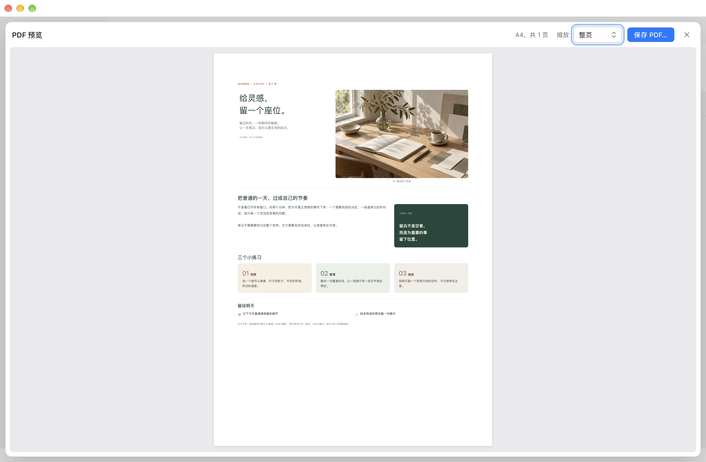
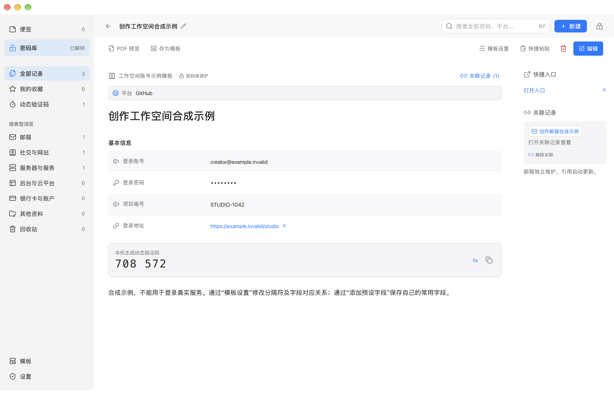
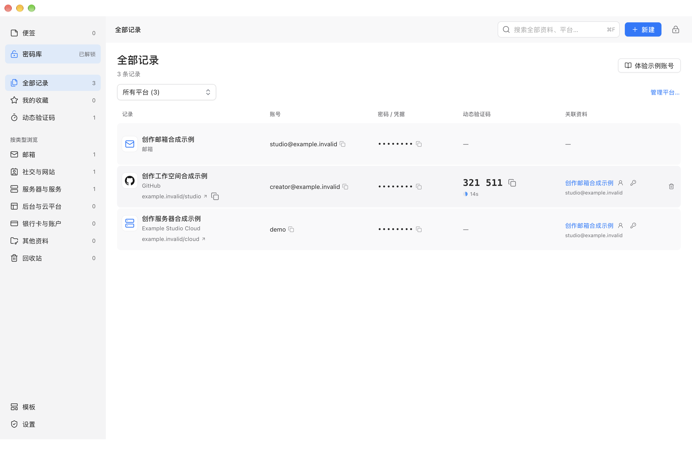
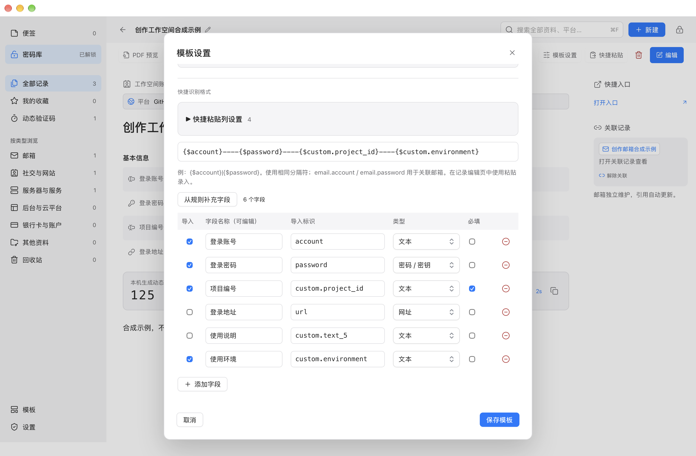

# Kernpad 使用手册

[返回项目首页](../README.md)

[English](guide.en.md)

**把备忘录与密码管理器放在同一个本地工作空间。** Kernpad 支持 Markdown、HTML 内容转换、富文本、多栏图文排版与 PDF，也提供加密密码库、关联账号、自定义模板和动态验证码。

版本 **1.0.0**，采用 [MIT 许可证](../LICENSE)。由维护者定义产品需求，使用 **GPT-6 编写并迭代代码**。

## 适合怎样使用

| 需求 | 使用方式 |
| --- | --- |
| 日常备忘、会议记录、项目计划 | 创建普通便签，用富文本、待办、表格和代码组织内容 |
| 精致图文、旅行手记、设计提案 | 使用分栏、跨行、色块、图片和本地视频，按需预览或导出 PDF |
| 保存账号、密码、服务器和 API 凭据 | 使用密码库，配置字段、平台、关联邮箱和验证码 |
| 重复填写相同结构的内容 | 设计模板，设置默认模板，或按分隔符批量粘贴 |
| 只需短期保留的内容 | 创建临时便签，到期自动清理 |

应用离线运行，不需要云端账号，没有内置云同步或遥测。界面支持简体中文、英文及系统浅色、深色外观。普通便签与密码库的存储保护不同，见[安全边界](#安全边界)。

## 平台与安装

| 平台 | 要求与状态 |
| --- | --- |
| macOS | Apple Silicon，macOS 14 或更新版本；原生 AppKit 与 WKWebView |
| Windows | Windows 11 x64；原生 WPF 与 WebView2，需要 Microsoft Edge WebView2 Runtime |
| Windows ARM64 | 用于虚拟机开发验收，尚未提供受支持的 ARM64 发行包 |
| Intel Mac、Linux | 暂未提供原生客户端 |

窗口默认宽度为 1360 逻辑像素，最小宽度 1280；请使用能容纳窗口的桌面空间。Windows Hello 的成功认证仍需在具备受支持硬件的 Windows 真机上验收，虚拟机界面测试不能替代这一项。

如已有适合的平台发行包，可从 [Releases](https://github.com/iAsuner/Kernpad/releases) 选择与系统匹配的安装包，并核对同次发布的 `SHA256SUMS.txt`。发布包反映发布时的代码，`main` 分支可能包含后续修复。

- macOS：安装 `Kernpad.app`。更新前正常退出应用，保留已有签名身份与资料库。
- Windows：完整解压到自己的应用目录，例如 `%LOCALAPPDATA%\Programs\Kernpad\1.0.0`，运行 `Kernpad.exe`。不要只复制 EXE，旁边的 DLL、Web 资源和许可文件也需要保留。自包含发行包不需要 .NET SDK。
- 默认 macOS 构建为 ad-hoc 签名，没有 Apple 公证；Windows 发行包未配置受信任的发布者签名。系统可能要求本人确认。不要关闭系统安全保护或导入来历不明的证书。

### 让 AI 帮忙安装

把下面一句话交给能操作你电脑的 AI：

> 请从 https://github.com/iAsuner/Kernpad 安装 Kernpad：先读取仓库说明与 Releases，识别我的系统，自动下载匹配的官方发行包，核对 SHA-256 和签名后安装，保留已有资料与签名连续性；不要求我手动下载或输入命令，系统验证由我本人完成。若没有匹配的发行包，请明确说明。

仓库私有时，AI 需要已有的访问权限。安装不需要向 AI 提供密码、恢复密钥或个人资料库，也无需先克隆源码。下载和解压由 AI 在本机完成。

## 第一次打开

1. 在“设置 → 通用”选择界面语言和启动页面，可默认停留在便签或密码库。
2. 在便签页点击“新建”直接写作。全新资料库提供四篇可编辑示例；已有资料可从“示例文档”添加。
3. 需要保密内容时进入密码库，完成系统验证并单独保存恢复密钥。新库不设置额外的资料库密码。
4. 在“模板”搜索并使用模板，或从空白开始设计自己的排版与字段。
5. 根据习惯选择自动保存或手动保存，常用操作和快捷键集中在设置中查看。

内置示例展示图文杂志、旅行手记、Markdown 项目计划和 HTML 提案。示例媒体为原创合成素材，随应用离线提供；可以修改或删除，重复添加不会覆盖已有修改。

## 便签与文档编辑


### 内容与排版

支持标题、正文、引用、提示块、待办、有序和无序列表、表格、日期、标签、链接、代码、表单、验证码、分割线、图片和视频。富文本可调整粗体、斜体、行内代码、字号、颜色与对齐。代码块支持 JSON 格式化。

Markdown 和 HTML 会转换成可继续编辑的文档组件。Markdown 支持常用实用子集，不承诺完整 CommonMark；HTML 导入会移除脚本、事件、嵌入与远程图片，不执行原页面代码，也不保证逐像素还原网页。

在空行输入 `@`、点击行旁的 `+` 或工具栏“内容”插入组件。新标题和正文保持空白，提示文字不会作为正文保存。可在文档中间插入、拖动排序、连续或分别选择多个组件，再批量调整或删除。

右侧“排版”提供：

- 12 格精确分栏、半栏、三分之一栏、四分之一栏，以及单独一行或并排排列。
- 纵向跨行和“左大右双”布局，例如左侧一块，右侧上下两块。
- 背景随内容高度或同排等高，以及间距、内边距、背景、边框和圆角。
- 整篇文档的标题与说明显示开关。正文标题默认隐藏，未填写说明时不显示空说明。

点击顶部名称或侧栏右键“重命名”修改文档名称。改名保持正文标题原来的显示状态；标题或说明旁的叉号只隐藏对应区域，不清空文字。普通便签没有显式名称时，列表使用正文首行作为显示名称。

### 图片与视频

可以选择本地媒体，也可以直接拖入正文或指定栏位。空栏直接填入，已有内容保留。图片和视频提供删除入口，删除和整次导入支持撤销；阅读模式隐藏编辑控件。

原图最多 20 MB，单个视频最多 8 MB，一次最多 10 个文件且合计不超过 20 MB，并受资料库容量限制。视频支持 MP4、MOV、M4V；实际解码取决于系统支持的编码。媒体不自动播放，PDF 使用视频封面。媒体随所属记录采用明文或加密存储。

### PDF 预览与导出



默认阅读和编辑视图随窗口铺开。点击“PDF 预览”显示 A4 分页，可适合宽度、适合整页或调整缩放；关闭后回到编辑位置。

预览与导出使用同一份当前内容快照，按阅读画布的栏位、字号、间距和背景整体等比缩放。预览缩放不会修改导出尺寸。密码和验证码密钥保持遮挡，视频替换为封面。手动保存模式下可以预览未保存修改，但预览不会替你保存正文。导出的 PDF 本身不加密。

### 保存与撤销

“设置 → 通用 → 自动保存文档”默认开启，也可关闭。

| 状态或操作 | 行为 |
| --- | --- |
| 自动保存 | 隐藏常规保存按钮和“已保存”提示，持续输入时界面保持稳定 |
| 自动保存耗时较长 | 超过 0.8 秒才显示保存进度，至少保留 0.6 秒，完成后安静收起 |
| 自动保存失败 | 立即显示错误和“重试保存”，保留修改 |
| 手动模式没有改变，或撤销回已保存内容 | 保存按钮灰显并显示“已保存” |
| 手动模式有修改 | 保存按钮可用，点击保存或使用快捷键；写入中显示进度，失败可重试 |
| 手动模式切换文档或正常退出 | 询问保存、放弃或取消 |
| 密码库安全锁定 | 不等待保存对话框，将未提交修改单独加密暂存为本机草稿 |
| 解锁后重新打开原记录 | 可继续草稿；正式记录已变化时先询问是否恢复 |

撤销和重做覆盖文字、字段、媒体与排版；离开记录或锁定后清除撤销历史。草稿不进入备份，重要修改应先保存。普通便签与草稿为明文；断电前仍只存在内存中的修改不保证能恢复。模板与应用设置有各自的保存操作。

### 临时便签

在通用设置中直接设定默认有效期，范围为 1 分钟至 365 天，初始为一天。便签页点击“临时便签”立即使用该默认值创建，不再次弹出时间选择。

文档顶部显示到期时间。点击它可以修改当前便签的剩余期限或转为普通便签；修改单篇不会改变默认值，取消不会重新计时。

到期删除正文、附件和本机草稿，不进入回收站或应用备份。应用关闭期间到期的内容，下次启动时清理。未保存修改也受期限约束；移入密码库会取消自动销毁。此功能不能撤回已经复制、导出或被系统快照保留的内容，也不承诺存储介质上的安全擦除。

## 密码库



### 解锁与锁定

查看已有受保护资料需要系统验证或恢复密钥。macOS 使用 Secure Enclave 的受保护私钥操作及本人验证，Windows 使用 Windows Hello 私钥操作与 TPM 构成证明检查。认证取消、失败或不可用时保持锁定。

已解锁后切换到普通便签不会立即锁定。闲置时间从最近一次应用内操作开始计算；验证码自动刷新不延长闲置时间。设置可调整闲置时长、最长会话和后台锁定策略。手动锁定、锁屏、睡眠和退出仍会结束会话。

### 字段、平台与关联

密码库可保存账号、密码、邮箱、服务器、API 凭据、银行卡资料及受保护文档。提供 20 类内置模板，默认模板主页仅展示 6 个基础模板与自定义模板；其余可搜索或切换“全部模板”查看。

字段可以设置名称、类型、是否必填和是否保密。可以自建平台，填写名称、网址和本地 Logo；也可以把其他邮箱或账号关联到当前记录。修改现有记录的字段名不会修改其他记录。

在记录顶部点击“关联记录”，按名称、账号或平台搜索，勾选后点击“应用关联”。阅读和编辑模式都有这个入口，第一条关联也可直接添加。取消或关闭窗口不会改变原关联；取消勾选再应用可解除关联，原记录及密码不会被删除或复制。关闭自动保存时，应用关联会进入编辑模式，继续点击“保存”才提交更改；编辑中的关联修改支持撤销与重做。

解锁后的列表按页显示主要账号、公开网址、密码存在标记和当前验证码。秘密账号保持遮挡；点击掩码密码由原生层复制，列表不会取得密码正文或验证码密钥。TOTP 支持 Base32、SHA-1、6 位数字和 30 秒周期，短信验证码不属于 TOTP。

普通便签中的验证码组件可以明确选择公开保存，这时密钥为明文；保密用途应放入密码库。

### 搜索、选择与删除



“全部记录”汇总当前密码库的各类账号。点击账号旁的复制按钮、掩码密码的复制按钮或验证码旁的复制按钮，直接取用对应内容；关联资料列还可打开邮箱，或复制关联账号与密码。密码复制由原生层完成，列表预览不包含密码正文或验证码密钥。按平台筛选或使用搜索可以缩小显示范围。

可按名称、平台和字段查找资料。解锁后的受保护正文搜索由原生层逐条匹配，最多返回 100 个记录 ID，不建立持久化明文正文索引；密码、验证码密钥、秘密账号和回收站内容不参与正文匹配。

在便签卡片或密码库列表的空白处拖动框选；macOS 用 `Command + 点击`、Windows 用 `Ctrl + 点击` 增减选择，`Shift + 点击` 连续选择。多选圆圈平时隐藏，进入多选或键盘聚焦时出现，覆盖原有图标而不挤占排版。`Escape` 取消选择，全选仅作用于当前可选择列表。

删除整篇文档或多条记录前会确认，默认焦点在取消。确认后进入回收站，可以恢复原记录及关联；永久删除需要明确确认。临时便签到期清理不经过回收站。

## 自定义模板与快捷粘贴

### 从使用到设计

“模板”直接打开主内容区，支持按名称、字段或导入标识搜索。顶部提供收藏与常用模板，点击模板即可使用；收藏和使用记录保存在本机。

可以从“设计模板”创建空白排版，也可以把现有文档“存为模板”。保存时保留排版、普通文字和媒体，清空账号、密码、表单值与验证码密钥。模板结构和公开样例为明文，保存前应检查普通文字和附件中是否夹带秘密。

模板设置集中管理名称、分类、所属板块、字段、导入规则与列表展示。自定义文档模板可选择便签或密码库。添加字段直接新增一行，名称、类型和新字段导入标识可在表格中修改；空字段名不能保存。



图中“使用环境”使用自定义导入标识 `custom.environment`，“项目编号”设为必填。取消“登录地址”和“使用说明”的导入勾选，只会将它们移出快捷粘贴规则，字段仍保留在模板中。点击“保存模板”后可以在模板主页查找、使用或继续调整。

设置中的新便签默认模板和新密码记录默认模板相互独立。便签页点击新建始终创建便签；密码库按正常解锁流程使用自己的默认模板。默认模板不存在或已归档时自动回退。修改模板主要影响之后新建的记录，已有内容保留。

### 组件 ID、导入标识与列表字段

| 名称 | 作用 |
| --- | --- |
| 内部组件 ID | 系统自动生成并隐藏，重排后仍识别同一个组件；新文档生成自己的 ID |
| 字段名称 | 用户看到的文字，可以修改 |
| 导入标识 | 快捷粘贴定位字段的稳定名称，例如 `custom.project_id`；选中组件时可在右侧排版顶部查看 |
| 快捷粘贴规则 | 指定分隔符及每一列填到哪个字段 |
| 密码库列表展示 | 指定外部列表使用哪个账号、密码、网址或验证码字段 |

模板设置可以在密码库锁定时编辑，不会因此要求解锁。读取或复制实际凭据仍需有效会话。模板字段与规则使用稳定对应关系，重排组件不会把粘贴内容填错位置。

### 列表的自动识别

列表映射旁的“自动识别如何工作”说明本机固定规则。手动指定优先；先检查基本字段，再检查表单字段，同级按字段顺序取第一项。

- 账号：先找导入标识 `account`，再匹配内置账号名称，最后取第一个非秘密字段。
- 密码：先找 `password`，再匹配名称含“密码”或“两步验证凭据”的字段，最后取秘密字段，排除入口、私钥、卡号和银行账号。
- 网址：优先网址类型或快捷入口字段，只显示有效的公开 HTTP/HTTPS 地址；不存在这些字段时才检查记录链接，排除带登录凭据的网址。
- 验证码：使用已有验证器和验证码组件；指定字段后只使用该字段或组件，列表不会显示密钥。

账号或密码命中后，即使为空也不继续跳到其他字段。自定义名称或英文名称建议直接指定字段。模板映射修改只影响之后新建的记录。

### 配置与使用快捷粘贴

在模板设置里选择分隔符、添加或删除导入列、指定字段和调整顺序。支持竖线、逗号、Tab 与最多 12 个字符的自定义分隔符。例如：

```text
{$account}----{$password}----{$custom.project_id}----{$email.account}
```

粘贴合成资料：

```text
creator@example.invalid----"Example----Password"----STUDIO-1042----studio@example.invalid
```

先查看遮挡密码与密钥的预览，确认后填入当前记录；多行可批量新建。值包含分隔符时用双引号包住整列，内部双引号写成两个。格式错误会阻止填入，未映射的字段保留原值。

`email.account`、`email.password`、`email.totp` 用于创建或复用关联邮箱；冲突或同地址歧义会阻止写入，不静默覆盖。每次最多映射 24 列。模板最多 256 个规则字段和 5,000 个组件，并受 32 MB 存储限制约束。

## 快捷键

“设置 → 快捷键”集中列出可自定义和固定操作，检查冲突并可恢复默认。下表中“主键”在 macOS 为 Command，在 Windows 为 Ctrl。

| 操作 | 默认组合 | 可修改 |
| --- | --- | --- |
| 新建、保存、搜索 | 主键 + N、主键 + S、主键 + F | 是 |
| 锁定密码库 | 主键 + Shift + L | 是 |
| 编辑或阅读 | 主键 + Shift + M | 是 |
| 打开便签、密码库、设置 | 主键 + 1、主键 + 2、主键 + , | 是 |
| 撤销、重做 | 主键 + Z、主键 + Shift + Z；Windows 也支持 Ctrl + Y | 否 |
| 加粗、斜体、行内代码 | 主键 + B、主键 + I、主键 + E | 否 |
| 剪切、复制、粘贴、全选 | 使用系统组合 | 否 |
| 当前栏内新段落或新列表项 | Enter | 否 |
| 段内换行 | Shift + Enter；macOS 也可 Control + Enter | 否 |
| 当前排后新开整行 | macOS Command + Enter，Windows Ctrl + Enter | 否 |
| 列表或代码缩进、退级 | Tab、Shift + Tab | 否 |
| 关闭弹窗或取消选择 | Escape | 否 |

## 备份、恢复与安全边界

### 备份与恢复密钥

密码库使用每库独立的随机 256 位数据密钥，按记录通过 AES-256-GCM 加密，记录身份参与认证。当前版本只支持 Kernpad v3 资料库与备份格式，不内置旧格式迁移。

恢复密钥由系统安全随机数生成，包含 256 位随机量，以 8 组、共 64 个十六进制字符显示。日常访问使用系统验证，恢复密钥用于换设备、原库丢失或本机验证不可用，需单独安全保管。

备份逐条重新加密；恢复创建新资料库并保留原库。原设备和原库仍在时，可在新的系统验证后恢复对应备份；否则需要恢复密钥。草稿与临时便签不进入备份，重要内容先保存。

错误恢复验证连续 3 次后开始冷却，从 2 秒逐步增加到最多 60 秒；成功后重置。计数仅属于当前进程，重启会重置。离线备份可以被反复尝试，防线是随机密钥的强度与保密性，不能靠界面限流保护弱密码。旧格式备份不能直接导入本版本。

### 安全边界

- 普通便签、公开验证码密钥、模板结构和公开模板样例为明文；凭据与受保护文档使用密码库。
- 正文按需逐条读取，列表预览最多请求 40 个 ID；列表不接收密码、正文或验证码密钥。换会话和锁定后清理详情与预览。
- 原生保存采用带会话票据的补丁与原子文件替换，摘要不能覆盖未打开的正文；保存失败保留修改。
- 网页界面离线加载，不执行导入 HTML 的脚本。PDF 使用独立受限渲染环境，但导出文件不加密。
- 不能保证抵御已经控制应用进程的攻击者、恶意重打包、全部内存副本、整库旧文件回滚或历史备份泄露。剪贴板清理不能撤回其他程序已复制的内容。
- ad-hoc 或自签名只能提供相应的完整性检查，不等于可信发布者、公证或独立安全认证。
- 项目没有独立第三方安全审计。Windows Hello / TPM 成功认证仍需专项真机验收。

漏洞报告方式见 [SECURITY.md](../SECURITY.md)。不要将真实密码、恢复密钥或个人资料库提交到 issue、仓库或聊天中。

## 开发、实现与验证

仓库保留源码、构建与测试脚本、合成测试夹具、应用必需资源及产品说明。生成应用、发布包、日志、缓存和本机验收报告不作为源码分发。docs/images 中经过检查的合成资料界面截图用于产品文档。

| 目录或文件 | 职责 |
| --- | --- |
| `Source/main.swift` | macOS 窗口、菜单、系统验证与原生桥 |
| `Source/VaultStore.swift`、`VaultCrypto.swift`、`DeviceUnlock.swift` | 存储、加密、会话与本机受保护密钥操作 |
| `Source/Web/` | 共享编辑器、模板、列表、布局、语言与保存流程 |
| `Source/PDFExporter.swift`、`MediaAttachment.swift` | macOS PDF 与媒体处理 |
| `Source/Examples/`、`Source/Tests/Fixtures/` | 离线示例资源与合成测试夹具 |
| `Windows/Kernpad.Core/` | Windows 加密、存储和跨平台备份格式 |
| `Windows/Kernpad.Windows/` | WPF、WebView2、Windows Hello 与系统服务 |
| `Source/Tests/`、`Windows/Kernpad.Tests/`、`Windows/Kernpad.Smoke/` | 模型、安全、存储、界面与流程检查 |
| `Source/Performance/`、`Windows/Kernpad.Performance/` | 独立性能测量工具 |

macOS Bundle ID 为 `app.kernpad.desktop`。受保护密钥操作使用 Kernpad 独立域标识；资料位于应用沙盒内的 `Application Support/Kernpad`。Windows 资料位于 `%LOCALAPPDATA%\Kernpad`。格式和身份变更需要独立的迁移设计。

### macOS 构建与安装

需要 Xcode Command Line Tools、Python 3.9+ 和 Node.js 22+，不需要 npm 安装或付费开发者账号。

```sh
zsh Source/test.sh
zsh Source/test-documents.sh
zsh Source/build.sh
open Kernpad.app
```

正常退出应用后，运行 `python3 Source/install-local.py` 更新 `/Applications/Kernpad.app`。安装器核对身份、签名和构建收据，暂存后替换，失败回滚，不修改资料库。`zsh Source/package.sh` 生成 ZIP；可用 `KERNPAD_SIGNING_IDENTITY` 指定已有签名身份，签名失败不降级。

### Windows 构建与流程验收

需要 .NET 10 SDK、Python 3.9+、Node.js 22+ 和运行界面所需的 WebView2 Runtime。在 Windows 项目根目录执行：

```powershell
powershell -File Windows/build.ps1
dotnet run --project Windows/Kernpad.Smoke -- --workflows Windows/Artifacts/workflows
```

构建脚本运行共享 Web 与原生存储检查，再发布自包含 x64 包。`--workflows` 使用临时合成资料库执行中英文连续操作，生成结果与截图。Windows 自签名验证脚本为 `Windows/test-self-sign.ps1`，仅在全新的可丢弃 Windows 测试账号中运行；发现已有 Kernpad 资料目录时会停止。它检查签名、篡改拒绝、真实窗口启动、示例文档落盘与正常退出。自签名不自动加入信任根，也不会获得 SmartScreen 信誉。

### 修改与测试

修改 `Source/Web/` 源文件后运行 `python3 Source/build-web.py`，不要直接编辑生成的 `app.js`、`app.css`、`index.html`。Web 层依赖原生宿主，不是可独立部署的密码库网站。

行为修改运行默认测试，编辑与布局修改另跑文档套件，原生集成修改需构建验证。所有测试只用合成资料和独立测试应用；系统验证由本人完成。自动测试、DOM 自动操作与真实键盘、鼠标、硬件认证各有不同范围，不能相互替代，也不能以测试数量推断没有漏洞。

仓库检查使用 `python3 Source/check-repository.py`，CI 定义在 `.github/workflows/ci.yml`。性能测量方法见 [独立性能测试](../Source/Performance/README.md)。结束开发和测试进程后，可运行 `python3 Source/clean.py --dry-run` 查看可清理产物，再用 `python3 Source/clean.py` 清理；保留 Git 历史与用户已安装应用、资料库。
